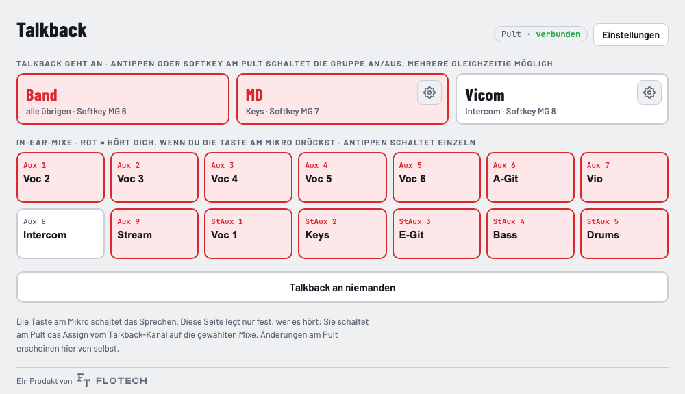
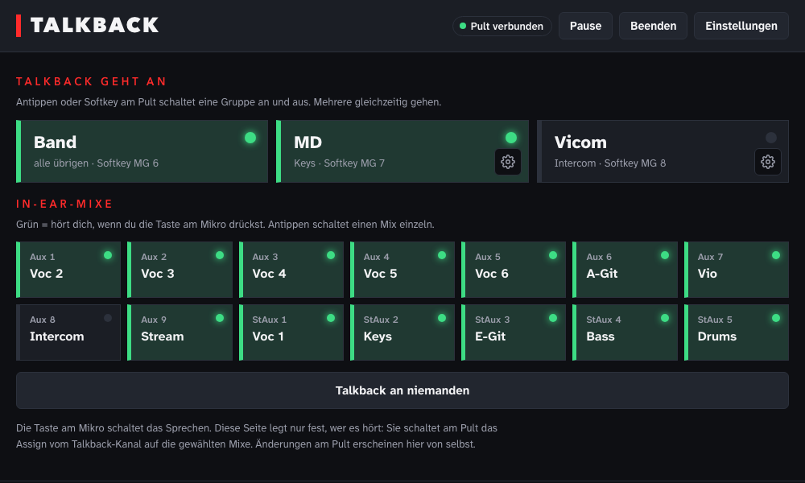
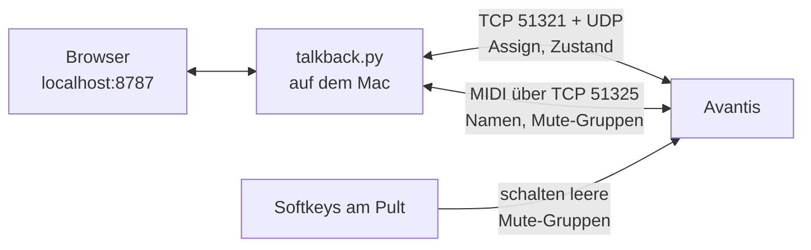
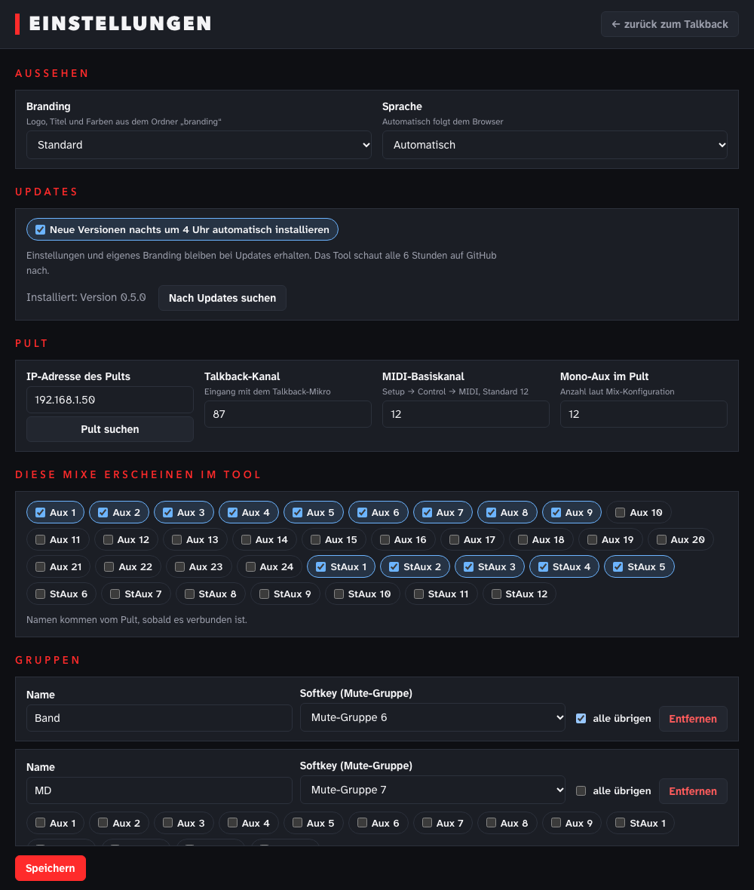

# Talkback für Allen & Heath Avantis

[English](README.md) · **Deutsch**

> [!WARNING]
> **Frühe Entwicklung. Nutzung auf eigene Gefahr.**
> Das Tool spricht mit dem Pult über ein Netzwerkprotokoll, das Allen & Heath nicht dokumentiert. Bei unserem Avantis (Firmware V2.01 Rev. 97241) läuft es, an anderen Aufbauten oder nach einem Firmware-Update kann es sich falsch verhalten. **Teste es zuerst außerhalb von Gottesdienst oder Show**, mit jemandem am Pult. Keine Gewährleistung, siehe [LICENSE](LICENSE).

**Wer hört mich, wenn ich ins Talkback-Mikro spreche?** Dieses Tool legt das fest, mit einem Klick im Browser oder einem Softkey am Pult. Statt das eingebaute Talkback des Pults zu nutzen, schaltet es das **Assign eines normalen Eingangskanals** auf die In-Ear-Mixe. Gruppen wie „Band“, „MD“ oder „Vicom“ lassen sich kombinieren.

<p align="center">
  
  
</p>

[](https://ko-fi.com/floslist)

---

## Warum es das gibt

Das eingebaute Talkback des Pults hat für uns einen großen Haken: **Die Musiker können nicht selbst einstellen, wie laut das Talkback in ihrem In-Ear-Mix ist.** Deshalb liegt unser Talkback-Mikro auf einem normalen Eingangskanal. So stellt jeder die Lautstärke selbst ein, wie bei jedem anderen Kanal auch.

Trotzdem wollen wir **einzeln steuern, wer uns hört**. Und das Pult hat keinen Softkey, der das Assign für mehrere Mixe gleichzeitig an- und ausschaltet. Deshalb habe ich dieses Tool gebaut.

## Was es kann

| | |
|---|---|
| 🎙️ **Echtes Assign** | Schaltet das Assign vom Talkback-Kanal auf Aux- und Stereo-Aux-Mixe an und aus, nicht nur den Send-Pegel |
| 🔄 **Immer synchron** | Mix-Namen und Zustand kommen live vom Pult. Ändert jemand etwas am Pult, sieht man es im Tool sofort |
| 👥 **Gruppen** | Beliebig viele, jede mit eigenem Namen und eigenen Mixen. Eine Gruppe kann „alle übrigen“ sein (z. B. Band). Mehrere gleichzeitig möglich |
| 🎛️ **Softkeys mit LED** | Softkeys am Pult schalten die Gruppen. Die LED leuchtet grün, wenn die Gruppe an ist, egal wo geschaltet wurde |
| ⚙️ **Einstellungsseite** | Pult-IP, Talkback-Kanal, Mixe und Gruppen, alles im Browser änderbar |
| 🔍 **Findet das Pult** | Lauscht im Netz auf das Pult und zeigt Modell und Firmware. Keine IP-Adressen abtippen |
| 🎨 **Branding** | Eigenes Logo, eigener Titel und eigene Farben pro Gemeinde oder Veranstaltungsort, aus einem Profil-Ordner |
| 🚀 **Läuft von selbst** | Startet bei der Anmeldung und nach einem Absturz neu. Nur Python 3, keine weiteren Pakete |

## Unterstützte Pulte

| Pult | Firmware | Stand |
|---|---|---|
| Allen & Heath **Avantis** | V2.01 Rev. 97241 | ✅ jeden Sonntag im Einsatz |
| Allen & Heath SQ | – | 🧪 Test bald |
| Allen & Heath dLive | – | 🔜 geplant |

Weitere Pulte kommen als eigene Treiber dazu. Du hast ein Pult und willst helfen? Mach ein Issue auf.

> 🙋 **Du hast ein dLive in oder um Berlin?** Ich würde gern einen halben Tag daran, um den Treiber zu bauen. [Melde dich hier](https://github.com/Floslis/avantis-talkback/issues/1).

## So funktioniert es



- **Assign und Zustand** laufen über das Netzwerkprotokoll, das auch Director und Mixing Station nutzen. Es ist nicht offiziell dokumentiert und wurde aus Mitschnitten nachgebaut
- **Namen und Softkeys** laufen über das offizielle MIDI-über-TCP-Protokoll
- **Softkey-Trick:** Ein Softkey mit „Custom MIDI“ hat keine steuerbare LED. Deshalb schaltet jeder Softkey eine **leere Mute-Gruppe**. Deren Zustand kann das Tool lesen und setzen, so bleibt die LED immer richtig

## Installation

1. **[Talkback.zip herunterladen](https://github.com/Floslis/avantis-talkback/releases/latest/download/Talkback.zip)**, immer die neueste Version
2. Den Ordner `Talkback` **direkt in den Benutzerordner** legen, Rechtsklick auf `Installieren.command` → Öffnen
3. Im Tool **Einstellungen** → **Pult suchen**

**📖 Schritt für Schritt, mit Einrichtung am Pult und Hilfe bei Problemen: [INSTALL.de.md](INSTALL.de.md)**

<p align="center"></p>

## Updates

Das Tool schaut alle 6 Stunden auf GitHub nach. Neue Versionen installieren sich **um 4 Uhr nachts** von selbst, so startet es nie mitten im Gottesdienst neu, oder sofort per Knopf im Hinweis. Getauscht werden nur Code-Dateien, deine Einstellungen und eigenen Branding-Profile bleiben. Die vorige Fassung liegt in `.sicherung/`. Automatische Updates lassen sich in den Einstellungen abschalten.

## Branding

Jedes Profil ist ein Ordner in `branding/` mit einer `profil.json` und optional einer `logo.svg`:

```json
{
  "name": "Meine Gemeinde",
  "titel": "Talkback",
  "logo": "logo.svg",
  "farben": {
    "dunkel": { "akzent": "#ff8a1f" },
    "hell":   { "akzent": "#c2410c" }
  }
}
```

Das Profil wählst du unter Einstellungen → Aussehen. Eigene Profile landen nicht im Git und überstehen Updates. Ein Beispiel liegt in `branding/beispiel/`.

## Roadmap

**Erledigt**
- [x] Einstellungen im Tool: Pult-IP, Kanal, Mixe, beliebig viele Gruppen
- [x] Branding-Profile: Logo, Titel, Farben
- [x] Updates von GitHub: Prüfung alle 6 Stunden, Installation um 4 Uhr nachts oder per Klick
- [x] Pult im Netz suchen, Mixe werden selbst erkannt
- [x] Neues Design, englische Oberfläche, Pause und Beenden

**Als Nächstes: Treiber-Aufbau**
- [ ] Den pultspezifischen Teil in Treiber auslagern (`pulte/avantis.py`), damit neue Pulte dazukommen, ohne den Rest anzufassen
- [ ] Test-Checkliste für Treiber: was man an einem neuen Pult in etwa 30 Minuten mitschneidet und ausprobiert

**Allen & Heath SQ** (zwei Pulte zum Testen bald verfügbar)
- [ ] Prüfen, was die SQ übers Netz kann (MIDI über TCP, natives Protokoll wie beim Avantis)
- [ ] Assign eines Eingangs auf Aux-Mixe mitschneiden und nachbauen
- [ ] Softkeys mit LED-Rückmeldung an der SQ
- [ ] SQ-Treiber, an beiden Pulten getestet

**Avantis: andere Mix-Konfigurationen**
- [ ] Mit anderer Zahl Mono- und Stereo-Aux testen, um zu beweisen, wo die Stereo-Aux im Protokoll liegen
- [ ] Gruppen und Matrizen als Ziele

**Allen & Heath dLive** (sobald ein Pult verfügbar ist)
- [ ] Dieselben Schritte wie bei der SQ: prüfen, mitschneiden, Treiber, testen

**Später**
- [ ] Bedienung vom Handy oder Tablet im lokalen Netz, abschaltbar

## Gut zu wissen

- Das Netzwerkprotokoll ist **nicht offiziell dokumentiert**. Ein Firmware-Update am Pult kann es ändern
- Getestet am Avantis mit Firmware V2.01 im laufenden Gottesdienst. Während der Entwicklung meldete das Pult einmal „Internal Error“, ohne Folgen für den Ton. Ursache war ein fehlendes Lebenszeichen, das ist behoben
- Das Tool lauscht nur auf dem eigenen Rechner (`127.0.0.1`), nicht im Netz
- Kein offizielles Produkt von Allen & Heath und nicht mit Allen & Heath verbunden

## Verwandte Projekte

- **[avantis-protocol](https://github.com/Floslis/avantis-protocol)**: das Netzwerkprotokoll hinter diesem Tool, dokumentiert für alle, die selbst etwas bauen wollen
- **[companion-module-allenheath-avantis-assign](https://github.com/Floslis/companion-module-allenheath-avantis-assign)**: Assign schalten mit Bitfocus Companion und Stream Deck (in Entwicklung)

## Unterstützen

Dir hilft das Tool? Über einen Kaffee freue ich mich sehr. ☕

[](https://ko-fi.com/floslist)

## Lizenz

[MIT](LICENSE) · Ein Projekt von **FLOTECH**, Veranstaltungstechnik und Film
