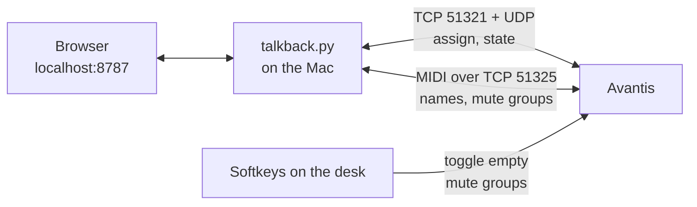

# Talkback for Allen & Heath Avantis

**English** · [Deutsch](README.de.md)

> [!WARNING]
> **Early development. Use at your own risk.**
> This tool talks to the desk through a network protocol that Allen & Heath does not document. It works on our Avantis (firmware V2.01 Rev. 97241), but it may misbehave on other setups or after a firmware update. **Test it outside of services and shows first**, with someone at the desk. No warranty, see [LICENSE](LICENSE).

**Who hears me when I talk into the talkback mic?** This tool decides, with one click in the browser or a softkey on the desk. Instead of the console's built-in talkback, it switches the **assign of a regular input channel** to your in-ear mixes. Groups like "Band", "MD" or "Vicom" can be combined.

<p align="center">
  
  
</p>

[](https://ko-fi.com/floslist)

> The interface is currently in German. An English interface is on the roadmap.

---

## Why this exists

The console's built-in talkback has one big drawback for us: **musicians can't set how loud the talkback is in their own in-ear mix.** So we put the talkback mic on a regular input channel instead. Now everyone sets the level themselves, like any other channel.

But we still want to decide **who hears us**, mix by mix. And the desk has no softkey that switches the assign on and off for several mixes at once. So I built this tool.

## Features

| | |
|---|---|
| 🎙️ **Real assign** | Switches the talkback channel's assign to aux and stereo aux mixes, not just the send level |
| 🔄 **Always in sync** | Mix names and state come live from the desk. Changes made on the desk show up instantly |
| 👥 **Groups** | As many groups as you like, each with its own name and mixes. One group can be "all others" (e.g. Band). Combine several at once |
| 🎛️ **Softkeys with LED** | Softkeys on the desk toggle the groups. The LED lights green when a group is on, no matter where it was switched |
| ⚙️ **Settings page** | Desk IP, talkback channel, mixes and groups, all editable in the browser |
| 🎨 **Branding** | Your own logo, title and colours per venue, from a profile folder |
| 🚀 **Runs by itself** | Starts at login and restarts after a crash. Only needs Python 3, no extra packages |

## Supported desks

| Desk | Firmware | Status |
|---|---|---|
| Allen & Heath **Avantis** | V2.01 Rev. 97241 | ✅ in use every Sunday |
| Allen & Heath dLive | – | 🔜 planned |
| Allen & Heath SQ | – | 🔜 planned |

More desks will come as separate drivers. Have a desk and want to help? Open an issue.

## How it works



- **Assign and state** use the network protocol that Director and Mixing Station use. It is not officially documented and was rebuilt from packet captures
- **Names and softkeys** use the official MIDI over TCP protocol
- **Softkey trick:** a softkey set to "Custom MIDI" has no controllable LED. So each softkey toggles an **empty mute group** instead. The tool can read and set its state, which keeps the LED correct

## Installation

**Requirements:** a Mac on the same network as the desk, Python 3 (macOS offers to install it if missing)

1. [Download the latest version](../../archive/refs/heads/main.zip) and unzip it
2. Put the folder **directly into your home folder**
   > ⚠️ Not on the Desktop, in Documents or in Downloads. macOS does not let background services read files there, and the tool won't start. The installer checks this and warns you
3. **Right-click `Installieren.command` → Open**
4. Your browser opens http://localhost:8787. The top shows "Pult · verbunden" (desk connected)

Just trying it out, without autostart: `python3 talkback.py`
Uninstall: `Deinstallieren.command`

## Setting up the desk

1. Patch the **talkback mic** to a free input channel and make sure it can be assigned to your in-ear mixes
2. Turn on **network MIDI**: Setup → Control → MIDI, note the base channel (default 12)
3. Pick **one empty mute group per group** and put a **softkey** on each
4. In the tool, open **Einstellungen** (settings) and enter the desk IP, talkback channel, mixes and groups

<p align="center"></p>

## Branding

Each profile is a folder in `branding/` with a `profil.json` and an optional `logo.svg`:

```json
{
  "name": "My Church",
  "titel": "Talkback",
  "logo": "logo.svg",
  "farben": {
    "hell":   { "an": "#c2410c", "an-hell": "#ffedd5" },
    "dunkel": { "an": "#fb923c", "an-hell": "#3b1d0c" }
  }
}
```

Choose the profile under Einstellungen → Aussehen. Your own profiles are not tracked by Git and survive updates. See `branding/beispiel/` for an example.

## Roadmap

- [x] Settings in the tool: desk IP, channel, mixes, any number of groups
- [x] Branding profiles: logo, title, colours
- [ ] **Updates from GitHub:** the tool checks for new versions and updates itself
- [ ] **More desks** via drivers: dLive, SQ
- [ ] **English interface**
- [ ] **Control from phone or tablet** on the local network, optional

## Good to know

- The network protocol is **not officially documented**. A firmware update on the desk may change it
- Tested on an Avantis with firmware V2.01 during live services. While developing, the desk once showed "Internal Error" with no effect on audio. The cause was a missing heartbeat, which is fixed
- The tool only listens on the local machine (`127.0.0.1`), not on the network
- Not an official Allen & Heath product and not affiliated with Allen & Heath

## Support

Does this tool help you? I'd be very happy about a coffee. ☕

[](https://ko-fi.com/floslist)

## License

[MIT](LICENSE) · A project by **FLOTECH**, event technology and film
