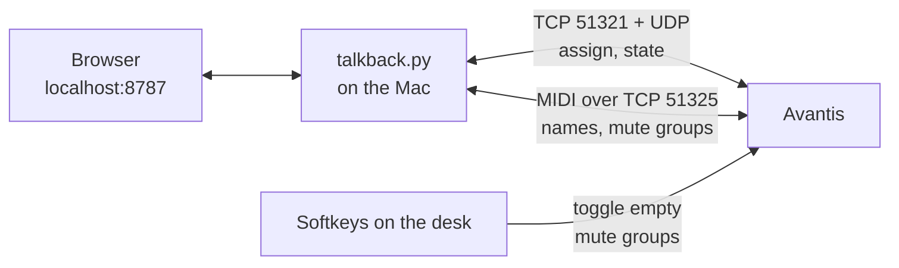

# Talkback for Allen & Heath desks

**English** · [Deutsch](README.de.md)

> [!WARNING]
> **Early development. Use at your own risk.**
> This tool talks to the desk through a network protocol that Allen & Heath does not document. It works on our Avantis (firmware V2.01 Rev. 97241), but it may misbehave on other setups or after a firmware update. **Test it outside of services and shows first**, with someone at the desk. No warranty, see [LICENSE](LICENSE).

**Who hears me when I talk into the talkback mic?** This tool decides, with one click in the browser or a softkey on the desk. Instead of the console's built-in talkback, it switches the **assign of a regular input channel** to your in-ear mixes. Groups like "Band", "MD" or "Vicom" can be combined.

<p align="center">
  
  
</p>

[](https://ko-fi.com/floslist)

---

## Why this exists

The console's built-in talkback has one big drawback for us: **musicians can't set how loud the talkback is in their own in-ear mix.** So we put the talkback mic on a regular input channel instead. Now everyone sets the level themselves, like any other channel.

But we still want to decide **who hears us**, mix by mix. And the desk has no softkey that switches the assign on and off for several mixes at once. So I built this tool.

## Features

| | |
|---|---|
| 🎙️ **Real assign** | Switches the talkback channel's assign to aux and stereo aux mixes, not just the send level |
| 🔄 **Always in sync** | Mix names and state come live from the desk. Changes made on the desk show up instantly |
| 👥 **Groups** | As many groups as you like, each with its own name and mixes. One group can be "all others" (e.g. Band). Combine several at once |
| 🎛️ **Softkeys with LED** | Softkeys on the desk toggle the groups. The LED lights green when a group is on, no matter where it was switched |
| ⚙️ **Settings page** | Desk IP, talkback channel, mixes and groups, all editable in the browser |
| 🔍 **Finds the desk** | Listens for the desk on the network and shows model and firmware. No typing IP addresses |
| 🎨 **Branding** | Your own logo, title and colours per venue, from a profile folder |
| 🚀 **Runs by itself** | Starts at login and restarts after a crash. Only needs Python 3, no extra packages |

## Related projects

- **[avantis-protocol](https://github.com/Floslis/avantis-protocol)**: the network protocol behind this tool, documented for anyone who wants to build their own
- **[companion-module-allenheath-avantis-assign](https://github.com/Floslis/companion-module-allenheath-avantis-assign)**: assign switching for Bitfocus Companion and Stream Deck (in development)

## Supported desks

| Desk | Firmware | Status |
|---|---|---|
| Allen & Heath **Avantis** | V2.01 Rev. 97241 | ✅ in use every Sunday |
| Allen & Heath SQ | – | 🧪 testing soon |
| Allen & Heath dLive | – | 🔜 planned |

More desks will come as separate drivers. Have a desk and want to help? Open an issue.

> 🙋 **Got a dLive in or around Berlin?** I'd love to spend half a day with one to build the driver. [Get in touch here](https://github.com/Floslis/allenheath-talkback/issues/1).

## How it works



- **Assign and state** use the network protocol that Director and Mixing Station use. It is not officially documented and was rebuilt from packet captures
- **Names and softkeys** use the official MIDI over TCP protocol
- **Softkey trick:** a softkey set to "Custom MIDI" has no controllable LED. So each softkey toggles an **empty mute group** instead. The tool can read and set its state, which keeps the LED correct

## Installation

1. **[Download Talkback.zip](https://github.com/Floslis/allenheath-talkback/releases/latest/download/Talkback.zip)**, always the latest version
2. Put the `Talkback` folder **directly into your home folder** and right-click `Installieren.command` → Open
3. In the tool, open **Settings** → **Find desk**

**📖 Step by step, including desk setup and troubleshooting: [INSTALL.md](INSTALL.md)**

<p align="center"></p>

## Updates

The tool checks GitHub every 6 hours. New versions install themselves **at 4 am**, so it never restarts during a service, or right away with the button in the banner. Only code files are replaced, your settings and own branding profiles stay. The previous version is kept in `.sicherung/`. Automatic updates can be turned off in the settings.

## Branding

Each profile is a folder in `branding/` with a `profil.json` and an optional `logo.svg`:

```json
{
  "name": "My Church",
  "titel": "Talkback",
  "logo": "logo.svg",
  "farben": {
    "dunkel": { "akzent": "#ff8a1f" },
    "hell":   { "akzent": "#c2410c" }
  }
}
```

Choose the profile under Settings → Appearance. Your own profiles are not tracked by Git and survive updates. See `branding/beispiel/` for an example.

## Roadmap

**Done**
- [x] Settings in the tool: desk IP, channel, mixes, any number of groups
- [x] Branding profiles: logo, title, colours
- [x] Updates from GitHub: checks every 6 hours, installs at 4 am or with one click
- [x] Find desk on the network, mixes detected automatically
- [x] New design, English interface, pause and quit

**Next: driver architecture**
- [ ] Split the desk-specific part into drivers (`pulte/avantis.py`), so new desks plug in without touching the rest
- [ ] Driver test checklist: what to capture and try at a new desk in about 30 minutes

**Allen & Heath SQ** (two desks available for testing soon)
- [ ] Check what the SQ offers over the network (MIDI over TCP, native protocol like the Avantis)
- [ ] Capture and rebuild assign of an input to aux mixes
- [ ] Softkeys with LED feedback on the SQ
- [ ] SQ driver, tested on both desks

**Avantis: other mix configurations**
- [ ] Test with different numbers of mono and stereo auxes, to prove where stereo auxes sit in the protocol
- [ ] Groups and matrices as targets

**Allen & Heath dLive** (when a desk is available)
- [ ] Same steps as the SQ: check, capture, driver, test

**Later**
- [ ] Control from phone or tablet on the local network, optional

## Good to know

- The network protocol is **not officially documented**. A firmware update on the desk may change it
- Tested on an Avantis with firmware V2.01 during live services. While developing, the desk once showed "Internal Error" with no effect on audio. The cause was a missing heartbeat, which is fixed
- The tool only listens on the local machine (`127.0.0.1`), not on the network
- Not an official Allen & Heath product and not affiliated with Allen & Heath

## Support

Does this tool help you? I'd be very happy about a coffee. ☕

[](https://ko-fi.com/floslist)

## License

[MIT](LICENSE) · A project by **FLOTECH**, event technology and film
